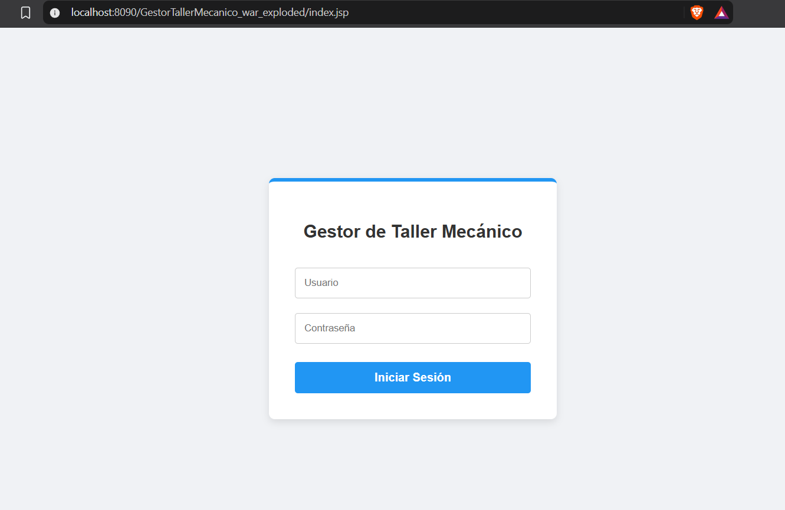
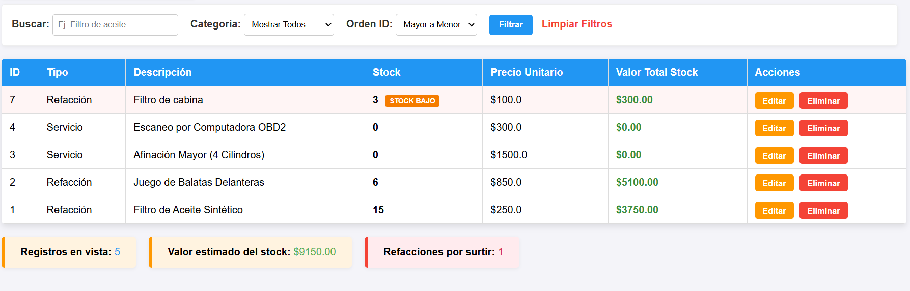
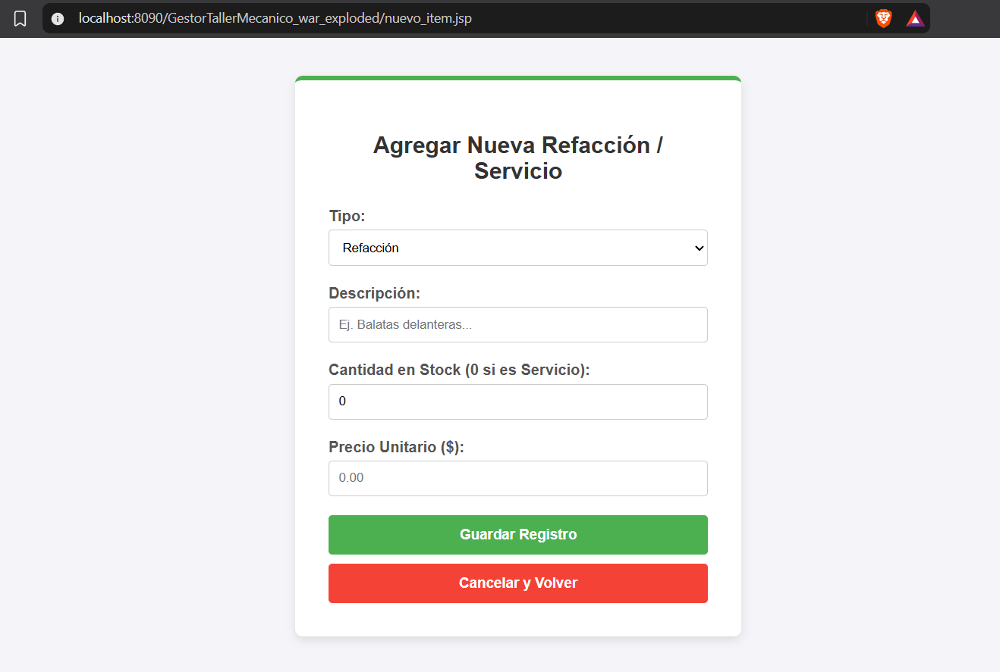
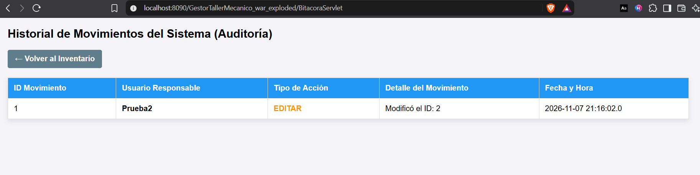

# Gestor de Refacciones y Servicios para Taller Mecánico

Aplicación web desarrollada en Java (Jakarta EE) y MySQL para la administración integral de inventario, control de acceso basado en roles y auditoría de movimientos en un taller mecánico.

**Equipo de Desarrollo — Ingeniería en Tecnologías de la Información (Grupo 801, UPVM):**
* Juarez Lanche Carlos
* Pacheco Alvarado Jose Uriel
* Valle Jimenez David Alonso

---

## 1. Descripción del Proyecto
* **Definición del problema:** En muchos talleres mecánicos locales, el registro de refacciones y servicios se lleva de forma manual o descentralizada. Esto provoca desabasto imprevisto de piezas críticas, errores en el cálculo del valor del inventario y falta de trazabilidad para saber qué empleado registró, modificó o eliminó algún artículo.
* **Objetivo del sistema:** Implementar una plataforma web centralizada con arquitectura en capas (Controladores Servlets, capa de acceso a datos DAO, modelos DTO y vistas JSP) que permita gestionar el stock en tiempo real, aplicar políticas estrictas de seguridad en contraseñas y auditar cada movimiento realizado dentro del sistema.
* **Usuarios destinatarios:**
    * **Administrador:** Cuenta con acceso total al inventario, facultad para dar de alta nuevos perfiles de usuario con contraseñas temporales y acceso exclusivo a la bitácora de auditoría de movimientos.
    * **Mecánico / Operador:** Personal operativo encargado de consultar existencias, registrar nuevas refacciones o servicios, actualizar cantidades tras una reparación y dar de baja artículos obsoletos.

---

## 2. Lista de Funcionalidades
* **Configuración Inicial Automatizada (`SetupAdminServlet`):** Al iniciar la aplicación por primera vez con una base de datos vacía, el sistema redirige automáticamente a un asistente para crear la primera cuenta de Administrador.
* **Autenticación y Seguridad de Contraseñas (`LoginServlet` / `CambiarPasswordServlet`):**
    * Protección de rutas y vistas mediante sesiones HTTP (`HttpSession`) y cierre de sesión seguro (`LogoutServlet`).
    * Cambio obligatorio de contraseña temporal en el primer inicio de sesión mediante el indicador `requiere_cambio`.
    * Validación estricta de contraseñas: mínimo 5 caracteres, al menos una letra mayúscula, un número, un carácter especial y prohibición de contener o repetir el nombre de usuario.
* **Módulo CRUD de Inventario (`InventarioServlet`, `RegistroItemServlet`, `EditarItemServlet`, `EliminarItemServlet`):** Alta, consulta, edición y baja de refacciones y servicios utilizando consultas preparadas (`PreparedStatement`) para prevenir inyección SQL.
* **Consultas Avanzadas y Estadísticas en Tiempo Real:**
    * Búsqueda dinámica por texto en la descripción del artículo.
    * Filtrado por categoría (`Refacción`, `Servicio` o `Todos`) y ordenamiento de registros por ID (`Mayor a Menor` o `Menor a Mayor`).
    * Cálculo automático del **Valor Total Stock** por fila (`cantidad_stock * precio`) y tarjetas inferiores con métricas globales (registros en vista, valor estimado del stock y refacciones por surtir).
* **Alertas Visuales de Stock Crítico:** Resaltado automático en color rojo y etiquetas de advertencia (`AGOTADO` cuando el stock es `0` y `STOCK BAJO` cuando es menor o igual a `3` unidades en refacciones).
* **Panel Administrativo y Bitácora de Auditoría (`BitacoraServlet`):** Registro automático e inmutable en base de datos cada vez que un usuario realiza una acción (`CREAR`, `EDITAR` o `ELIMINAR`), almacenando el usuario responsable, la descripción del cambio y la fecha/hora exacta.

---

## 3. Guía de Uso

### Flujo de Navegación del Usuario
1. **Configuración Inicial (Primer uso):** Si la tabla `usuarios` está vacía, al entrar a `/` se muestra `setup_admin.jsp` para registrar al primer Administrador.
2. **Inicio de Sesión (`index.jsp`):** El usuario ingresa sus credenciales. Si su cuenta fue creada por un administrador con clave temporal, el sistema lo redirige a `cambiar_password.jsp` para establecer su contraseña definitiva antes de permitirle el acceso.
3. **Panel Principal de Inventario (`inventario.jsp`):**
    * Visualiza la tabla general con el stock, precios unitarios, valor total por lote y alertas de desabasto.
    * Utiliza la barra superior para buscar por nombre, filtrar por tipo o cambiar el orden de los IDs.
    * Selecciona **+ Agregar Nueva Refacción/Servicio** (`nuevo_item.jsp`) para dar de alta un ítem, o usa los botones **Editar** (`editar_item.jsp`) y **Eliminar** en cada fila.
4. **Funciones Exclusivas de Administrador:**
    * **+ Crear Nuevo Perfil (`nuevo_usuario.jsp`):** Permite registrar cuentas con rol *Administrador*, *Mecánico* u *Operador*.
    * **Ver Bitácora de Movimientos (`bitacora.jsp`):** Muestra la tabla cronológica con todos los movimientos realizados por los usuarios en el inventario.
5. **Cierre de Sesión:** El botón **Cerrar Sesión** invoca a `LogoutServlet`, invalidando la sesión activa y regresando a la pantalla de acceso.

### Capturas de Pantalla Principales
* **Inicio de Sesión y Configuración Inicial:**
  
* **Panel Principal de Inventario, Filtros y Alertas de Stock:**
  
* **Formulario de Registro / Edición de Refacciones:**
  
* **Panel Administrativo y Bitácora de Auditoría:**
  

---

## 4. Modelo de Datos

El sistema opera sobre la base de datos relacional **`taller_mecanico`** en MySQL, estructurada en tres tablas principales:

### Diagrama Relacional (Lógico)
```text
+-----------------------+          +---------------------------+
|       usuarios        |          |         bitacora          |
+-----------------------+          +---------------------------+
| PK id_usuario (INT)   |          | PK id_movimiento (INT)    |
|    username (VARCHAR) | - - - -> |    usuario (VARCHAR)      |
|    password (VARCHAR) | (Audita) |    accion (VARCHAR)       |
|    rol (VARCHAR)      |          |    detalle (VARCHAR)      |
|    requiere_cambio    |          |    fecha (TIMESTAMP)      |
+-----------------------+          +---------------------------+
            |
            | (Gestiona CRUD)
            v
+---------------------------+
|     inventario_taller     |
+---------------------------+
| PK id_item (INT)          |
|    tipo_item (VARCHAR)    |
|    descripcion (VARCHAR)  |
|    cantidad_stock (INT)   |
|    precio (DECIMAL 10,2)  |
+---------------------------+
```

### Descripción de Tablas
1. **`usuarios`** *(Control de acceso, roles y políticas de seguridad)*
    * `id_usuario` (`INT`, `PRIMARY KEY`, `AUTO_INCREMENT`): Identificador único del usuario.
    * `username` (`VARCHAR(50)`, `UNIQUE`, `NOT NULL`): Nombre de acceso al sistema.
    * `password` (`VARCHAR(100)`, `NOT NULL`): Contraseña validada bajo políticas de seguridad.
    * `rol` (`VARCHAR(30)`, `NOT NULL`): Nivel de permisos (`Administrador`, `Mecánico`, `Operador`).
    * `requiere_cambio` (`TINYINT(1)`, `DEFAULT 1`): Bandera de seguridad (`1` obliga al cambio de clave al iniciar sesión; `0` permite acceso directo).
2. **`inventario_taller`** *(Almacenamiento central de refacciones y servicios)*
    * `id_item` (`INT`, `PRIMARY KEY`, `AUTO_INCREMENT`): Folio único del registro.
    * `tipo_item` (`VARCHAR(30)`, `NOT NULL`): Clasificación del registro (`Refacción` o `Servicio`).
    * `descripcion` (`VARCHAR(150)`, `NOT NULL`): Nombre o detalle técnico del artículo o trabajo.
    * `cantidad_stock` (`INT`, `NOT NULL`): Existencias físicas disponibles (`0` para servicios).
    * `precio` (`DECIMAL(10,2)`, `NOT NULL`): Costo unitario en moneda nacional.
3. **`bitacora`** *(Historial de auditoría de operaciones)*
    * `id_movimiento` (`INT`, `PRIMARY KEY`, `AUTO_INCREMENT`): Identificador consecutivo del evento.
    * `usuario` (`VARCHAR(50)`): Nombre del usuario autenticado que ejecutó la operación.
    * `accion` (`VARCHAR(50)`): Tipo de operación realizada (`CREAR`, `EDITAR`, `ELIMINAR`).
    * `detalle` (`VARCHAR(255)`): Descripción específica del ítem o ID afectado.
    * `fecha` (`TIMESTAMP`, `DEFAULT CURRENT_TIMESTAMP`): Marca de tiempo exacta del servidor en que ocurrió el movimiento.

---

## 5. Instrucciones de Instalación

### Prerrequisitos
* **Java Development Kit (JDK):** Versión 17 o superior.
* **Servidor de Aplicaciones:** Apache Tomcat 10.1 o superior (compatible con Jakarta EE 10).
* **Gestor de Base de Datos:** MySQL Server 8.0 o superior.
* **IDE y Gestor de Dependencias:** IntelliJ IDEA con soporte para Apache Maven.

### Paso 1: Configuración de la Base de Datos
Inicia sesión en tu servidor MySQL y ejecuta el siguiente script completo para crear la base de datos y sus tablas:

```sql
CREATE DATABASE IF NOT EXISTS taller_mecanico;
USE taller_mecanico;
CREATE TABLE usuarios (
    id_usuario INT AUTO_INCREMENT PRIMARY KEY,
    username VARCHAR(50) NOT NULL UNIQUE,
    password VARCHAR(100) NOT NULL,
    rol VARCHAR(30) NOT NULL,
    requiere_cambio TINYINT(1) DEFAULT 1
);
CREATE TABLE inventario_taller (
    id_item INT AUTO_INCREMENT PRIMARY KEY,
    tipo_item VARCHAR(30) NOT NULL,
    descripcion VARCHAR(150) NOT NULL,
    cantidad_stock INT NOT NULL,
    precio DECIMAL(10,2) NOT NULL
);
CREATE TABLE bitacora (
    id_movimiento INT AUTO_INCREMENT PRIMARY KEY,
    usuario VARCHAR(50),
    accion VARCHAR(50),
    detalle VARCHAR(255),
    fecha TIMESTAMP DEFAULT CURRENT_TIMESTAMP
);
```

### Paso 2: Configuración del Proyecto y Despliegue
1. **Clonar el repositorio:**
   ```bash
   git clone <https://github.com/AlonsoValle/GestorTallerMecanico.git>
   ```
2. **Importar en IntelliJ IDEA:** Abre la carpeta del proyecto como un proyecto **Maven** y espera a que se descarguen las dependencias definidas en `pom.xml` (`jakarta.servlet-api` y `mysql-connector-j`).
3. **Configurar credenciales de conexión:** Abre `src/main/java/com/taller/util/ConexionBD.java` y verifica que las variables `URL`, `USER` y `PASSWORD` coincidan con los datos de tu servidor local de MySQL.
4. **Compilar el proyecto:** En el menú superior selecciona **Build > Rebuild Project**.
5. **Configurar Apache Tomcat:**
    * Ve a **Run > Edit Configurations > Add New Configuration > Tomcat Server (Local)**.
    * En la pestaña **Deployment**, agrega el artefacto `GestorTallerMecanico:war exploded`.
    * Inicia el servidor y abre tu navegador en `http://localhost:8080/GestorTallerMecanico_war_exploded/` (o el puerto configurado en tu entorno).
6. **Primer acceso:** Al no existir registros previos en la tabla `usuarios`, el sistema te guiará automáticamente para dar de alta la cuenta principal de Administrador.